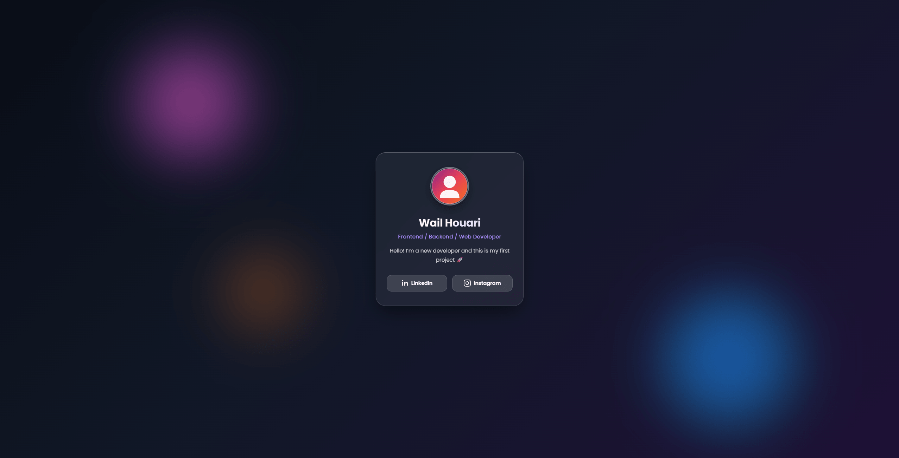

# First Project: Profile Card

A clean, responsive personal profile card built with modern HTML5 and pure CSS3.

[](https://developer.mozilla.org/en-US/docs/Web/HTML)
[](https://developer.mozilla.org/en-US/docs/Web/CSS)
[](https://github.com/wailhouari-dev/first-project-profile-card/blob/main/LICENSE)
[](https://wailhouari-dev.github.io/first-project-profile-card/)



## About

This is my very first web development project, built to practice the fundamentals of HTML5 and modern CSS3. The goal was to build a clean, responsive personal profile card from scratch without relying on frameworks, libraries, or build tools.

## Live Demo

Explore the live page on GitHub Pages:  
[https://wailhouari-dev.github.io/first-project-profile-card/](https://wailhouari-dev.github.io/first-project-profile-card/)

## Features

- **Glassmorphism Design:** Semi-transparent card styling with `backdrop-filter` blur and subtle borders.
- **Ambient Lighting:** Soft glowing background gradients that enhance the glass depth effect.
- **Centered Layout:** Uses CSS Flexbox to keep the card centered across viewports.
- **Interactive States:** Smooth hover and transition effects on the card, avatar, and buttons.
- **Social Links:** Dedicated buttons with custom SVG icons linking to LinkedIn and Instagram.
- **Mobile Responsive:** Adapts button arrangements and padding on smaller viewports.

## What I Learned

- Structuring semantic HTML5 elements and configuring client-side Content Security Policy (CSP).
- Aligning and centering components using CSS Flexbox properties.
- Working with modern CSS techniques like `backdrop-filter`, `rgba` colors, and custom transitions.
- Organizing reusable design tokens using CSS custom properties (`:root` variables).
- Making elements responsive with media queries for narrow mobile screens.

## Tech Stack

| Technology   | Purpose                                     |
| :----------- | :------------------------------------------ |
| HTML5        | Semantic structure and metadata             |
| CSS3         | Layout, styling, variables, and transitions |
| GitHub Pages | Static web hosting                          |

## Getting Started

### Prerequisites

All you need is a modern web browser (Google Chrome, Firefox, Safari, Edge).

### Installation

1. Clone the repository:
   ```bash
   git clone https://github.com/wailhouari-dev/first-project-profile-card.git
   ```
2. Navigate into the project folder:
   ```bash
   cd first-project-profile-card
   ```
3. Open `index.html` directly in your browser:
   - Double-click the file, or right-click and choose your preferred browser.
   - _(Optional)_ In Visual Studio Code, right-click `index.html` and select **Open with Live Server**.

## Project Structure

```plaintext
.
├── images/
│   ├── avatar-placeholder.svg  # Default vector avatar graphic
│   └── preview.png             # Project screenshot for README
├── style/
│   └── style.css               # Main stylesheet (layout, glassmorphism, variables)
├── index.html                  # Profile card markup and security configuration
└── README.md                   # Project documentation
```

## Possible Improvements

- [ ] Replace vector avatar placeholder with a personal photo
- [ ] Add a light/dark mode theme toggle
- [ ] Add subtle JavaScript interactivity (e.g., click-to-copy contact info)
- [ ] Add keyboard navigation indicators to improve accessibility

## License

This project is licensed under the MIT License - see the [LICENSE](https://github.com/wailhouari-dev/first-project-profile-card/blob/main/LICENSE) file for details.

## Author

- **Wail Houari**
- GitHub: [@wailhouari-dev](https://github.com/wailhouari-dev)
- LinkedIn: [wailhouari](https://www.linkedin.com/in/wailhouari)
- Instagram: [@wailhouari.dev](https://www.instagram.com/wailhouari.dev/)
